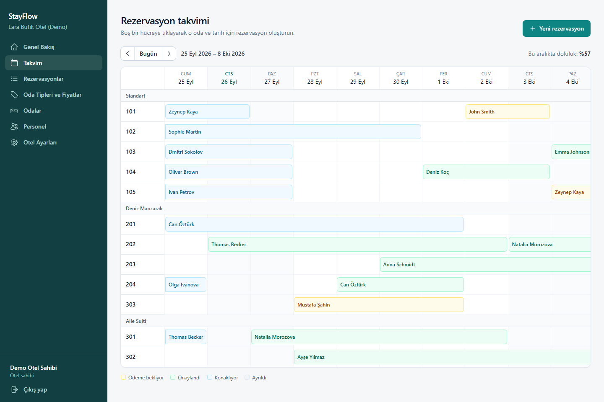
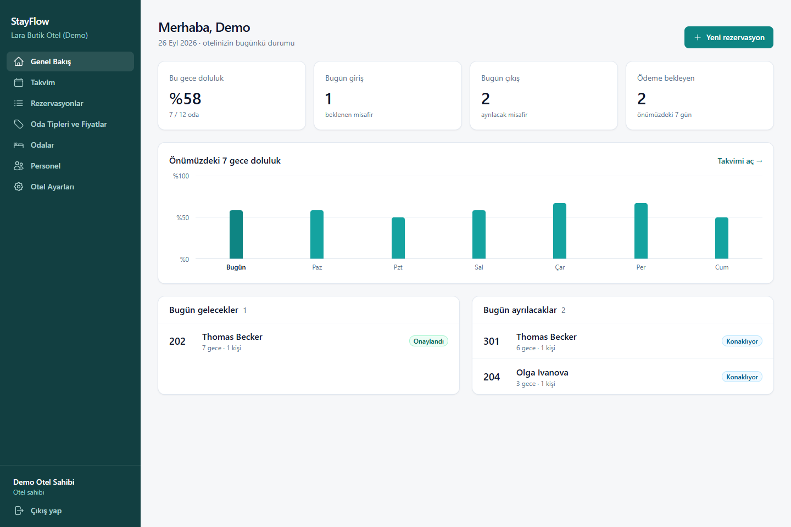
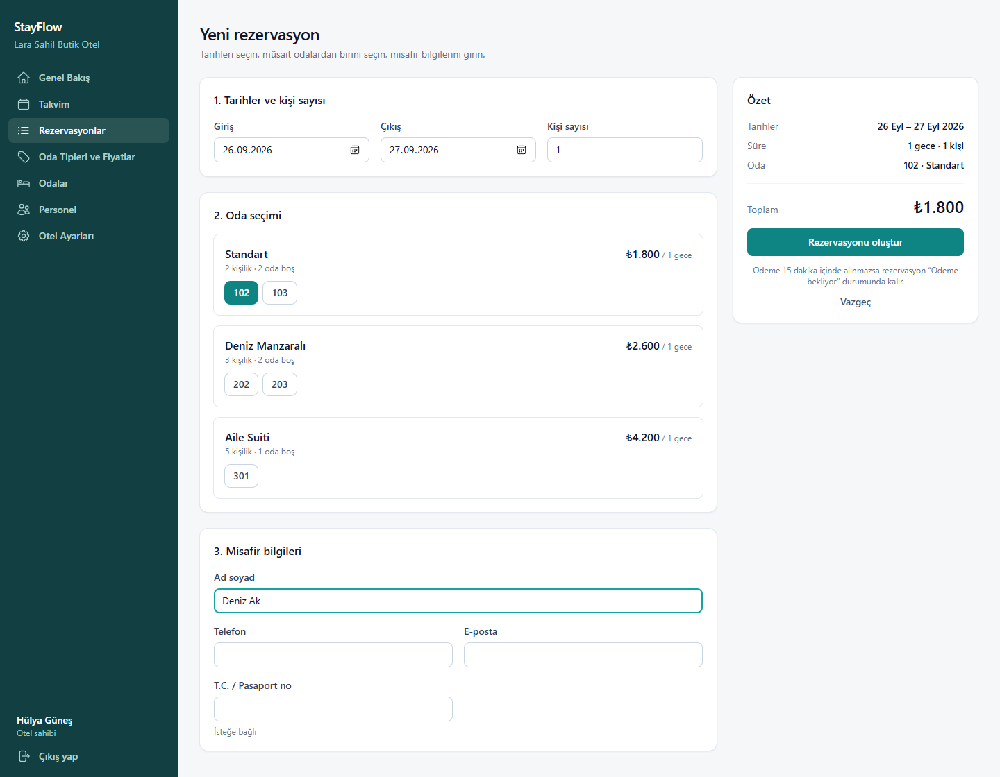

# StayFlow

Butik oteller ve pansiyonlar için çok kiracılı (multi-tenant) rezervasyon ve misafir yönetim sistemi.
Her otel kendi hesabıyla sisteme kaydolur; odalarını, fiyatlarını ve rezervasyonlarını yönetir ve yalnızca kendi verisini görür.

> Durum: **3. hafta tamamlandı**: backend, React yönetim paneli, Docker ve CI/CD.
> Canlı yayın için sunucu kurulumu [docs/deploy.md](docs/deploy.md) rehberinde.



## Teknolojiler

- **Backend:** .NET 10 · ASP.NET Core Web API · EF Core 10 · SQL Server · JWT + refresh token · xUnit
- **Altyapı:** Docker · Docker Compose · Nginx · GitHub Actions (CI + deploy) · GitHub Container Registry
- **Yönetim paneli:** React 19 · TypeScript · Vite · Tailwind CSS v4 · TanStack Query · React Router · React Hook Form + Zod · Vitest + Testing Library

## Yönetim paneli

| Genel bakış | Yeni rezervasyon |
|---|---|
|  |  |

- **Genel bakış:** bu geceki doluluk, bugünkü giriş/çıkışlar, ödeme bekleyenler ve önümüzdeki 7 gecenin doluluk grafiği.
- **Takvim:** odalar × geceler tablosu. Bloğa tıklayınca rezervasyon detayı (onayla / iptal et) açılır, boş hücreye tıklayınca o oda ve tarih için rezervasyon başlar.
- **Yeni rezervasyon:** tarih ve kişi sayısı girilince müsait oda tipleri toplam fiyatla listelenir. Siz formu doldururken oda başkasına satılırsa backend 409 döner; panel müsaitliği yenileyip yeni oda seçtirir.
- **Oda tipleri, sezon fiyatları, odalar, personel, otel ayarları.** Resepsiyon rolü oda ve fiyat ekranlarını salt okunur görür; personel ve ayarlar menüsü ona hiç görünmez.
- **Oturum:** access token süresi dolunca istek otomatik olarak yenilenip tekrarlanır. Aynı anda birden çok istek 401 alırsa tek bir refresh yapılır; backend refresh token'ı her kullanımda değiştirdiği için paralel refresh'ler birbirini geçersiz kılardı.

## Öne çıkan mühendislik problemi: çifte rezervasyon

İki misafir aynı anda aynı odayı aynı tarihler için ayırtmaya çalışırsa ne olur?
"Önce kontrol et, sonra kaydet" yaklaşımı tek başına yetmez: iki istek de kontrolü aynı anda geçip ikisi de kaydedebilir.

StayFlow'da her dolu gece `RoomNights` tablosunda bir satırdır ve `(RoomId, Date)` üzerinde **unique index** vardır.
Rezervasyon ve tüm geceleri tek transaction'da yazılır. Böylece yarışı kaybeden istek veritabanı seviyesinde reddedilir ve geriye hiçbir satırı kalmaz.
Uygulamadaki ön kontrol yalnızca kullanıcıya hızlı ve anlaşılır bir hata vermek içindir; asıl garanti veritabanındadır.

Bu davranış iki şekilde doğrulandı:

- **Otomatik test** (`ReservationServiceTests.Es_zamanli_iki_istekten_sadece_biri_basarili_olur`): Bir EF Core interceptor'ı, ön kontrol ile kayıt arasına rakip bir rezervasyon sokar. Unique index ikinci isteği reddeder ve 409 döner.
- **Gerçek yük** (SQL Server LocalDB): Aynı oda ve aynı geceler için 20 eşzamanlı HTTP isteği gönderildi. Sonuç 1 × `201 Created`, 19 × `409 Conflict` oldu. Bu 409'lardan bazıları ön kontrolü geçen, ama unique index tarafından reddedilen isteklerdir.

İptal edilen rezervasyonun `RoomNights` satırları silinir; o geceler yeniden satışa açılır.

## Mimari

```
backend/
├── StayFlow.Domain          → Entity'ler (Hotel, Room, Reservation, RoomNight...) ve enum'lar
├── StayFlow.Application     → Servisler, DTO'lar, iş kuralları, IApplicationDbContext
├── StayFlow.Infrastructure  → EF Core DbContext, migration'lar, şifre hashleme
├── StayFlow.API             → Controller'lar, JWT, hata yönetimi (ProblemDetails)
└── StayFlow.Tests           → xUnit + SQLite in-memory testler
admin-panel/
├── src/api                  → Tipli API istemcisi, token yenileme, DTO tipleri
├── src/auth                 → Oturum context'i, korumalı rotalar
├── src/components           → Layout ve paylaşılan UI bileşenleri
└── src/pages                → Ekranlar (takvim, rezervasyonlar, odalar...)
```

- **Multi-tenancy:** Her tenant entity'si `ITenantEntity` uygular. EF Core global query filter'ları, sorguları JWT'deki `hotelId` claim'ine göre otomatik filtreler. Tenant bilgisi yoksa hiçbir satır dönmez (fail-closed). Yeni kayıtlara `HotelId` otomatik atanır.
- **Başka otelin verisine erişim** 404 döner: filtre kaydı tamamen gizler, var olduğu bile sızmaz.
- **Kimlik doğrulama:** Kısa ömürlü access token (15 dk) ve refresh token (7 gün). Refresh token'lar veritabanında hash'lenmiş tutulur ve her kullanımda yenilenir (rotation).
- **Roller:** `Owner` (otel sahibi: oda, fiyat, personel yönetimi) ve `Reception` (rezervasyon işlemleri).

## Çalıştırma

### En kolay yol: Docker

Tek gereksinim Docker Desktop.

```bash
cp .env.example .env      # içindeki şifreleri değiştirin
docker compose up --build
```

SQL Server, API ve panel birlikte ayağa kalkar; veritabanı tabloları ilk açılışta otomatik oluşturulur.
Panel `http://localhost:8080` adresinde açılır.

### Geliştirme ortamı

Gereksinimler: .NET 10 SDK ve SQL Server LocalDB (Visual Studio ile birlikte gelir) ya da herhangi bir SQL Server.

```bash
cd backend
dotnet tool install --global dotnet-ef   # bir kere
dotnet ef database update -p StayFlow.Infrastructure -s StayFlow.API
dotnet run --project StayFlow.API --launch-profile http
```

API `http://localhost:5182` adresinde açılır. Örnek istekler [StayFlow.API.http](backend/StayFlow.API/StayFlow.API.http) dosyasındadır.

> `appsettings.Development.json` içindeki JWT anahtarı yalnızca yerel geliştirme içindir.
> Canlı ortamda anahtar `Jwt__SecretKey` ortam değişkeniyle verilmelidir (en az 32 karakter).

Yönetim paneli (Node.js 20+; API çalışırken ayrı bir terminalde):

```bash
cd admin-panel
npm install
npm run dev
```

Panel `http://localhost:5173` adresinde açılır; `/api` istekleri Vite üzerinden API'ye yönlendirilir.
"Ücretsiz kaydolun" bağlantısıyla bir otel oluşturup başlayabilirsiniz.

Testler:

```bash
cd backend && dotnet test          # 27 test
cd admin-panel && npm test         # 15 test
python scripts/smoke_test.py       # çalışan sisteme karşı uçtan uca test (Docker: localhost:8080)
```

## CI/CD

- **CI** ([ci.yml](.github/workflows/ci.yml)): Her push'ta backend ve frontend testleri paralel çalışır. İkisi de geçerse
  sistem Docker Compose ile ayağa kaldırılır ve [smoke_test.py](scripts/smoke_test.py) gerçek SQL Server'a karşı
  çalışır. Bu testin en önemli kontrolü, aynı oda için 20 eşzamanlı rezervasyondan tam olarak birinin kazanmasıdır.
- **Deploy** ([deploy.yml](.github/workflows/deploy.yml)): CI `main`/`master` dalında geçerse imajlar `ghcr.io`'ya yüklenir,
  sunucuya SSH ile bağlanılır ve yeni sürüm sağlık kontrolünden geçene kadar beklenir. Kurulum: [docs/deploy.md](docs/deploy.md).

## API

| Metot | Yol | Yetki |
|---|---|---|
| POST | `/api/auth/register` · `/login` · `/refresh` | Herkes |
| POST | `/api/auth/logout` | Giriş yapmış |
| GET / PUT | `/api/hotel` | Personel / Owner |
| GET / POST | `/api/users` | Owner |
| GET / POST / PUT / DELETE | `/api/room-types` | Okuma: personel, yazma: Owner |
| GET / POST / PUT / DELETE | `/api/room-types/{id}/seasonal-prices` | Okuma: personel, yazma: Owner |
| GET / POST / PUT / DELETE | `/api/rooms` (DELETE = pasife alma) | Okuma: personel, yazma: Owner |
| GET | `/api/availability?checkIn=&checkOut=&guests=` | Personel |
| GET / POST | `/api/reservations` | Personel |
| POST | `/api/reservations/{id}/confirm` · `/check-in` · `/check-out` · `/cancel` | Personel |

Hatalar RFC 7807 `ProblemDetails` formatında döner: 400 (doğrulama), 401, 403, 404, 409 (çakışma).

## Yol haritası

- [x] **1. hafta:** Auth ve roller, multi-tenancy, oda tipi/oda/sezon fiyatı, müsaitlik, rezervasyon ve çifte rezervasyon koruması, testler
- [x] **2. hafta:** React + TypeScript yönetim paneli: genel bakış, rezervasyon takvimi, rezervasyon akışı, oda/fiyat/personel yönetimi, testler
- [x] **3. hafta:** Docker Compose, GitHub Actions CI (Docker'da uçtan uca test dahil), GHCR + SSH ile otomatik deploy, Nginx + Let's Encrypt kurulum rehberi
- [ ] Sunucuya ilk kurulum ve canlı demo adresi
- [ ] Hangfire (ödenmeyen rezervasyonu 15 dk'da iptal), SignalR, Redis, Testcontainers, Serilog
- [ ] React Native misafir uygulaması, LLM ile yorum özetleme
